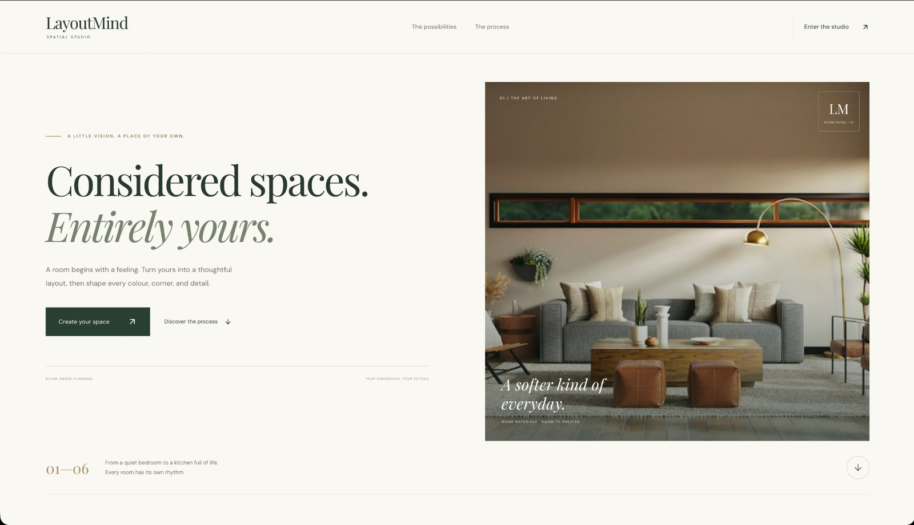
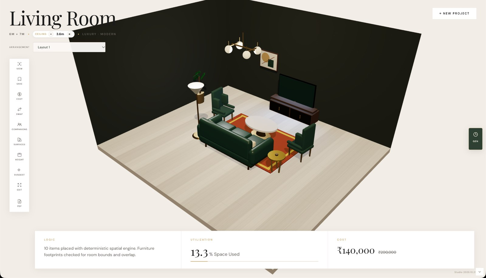
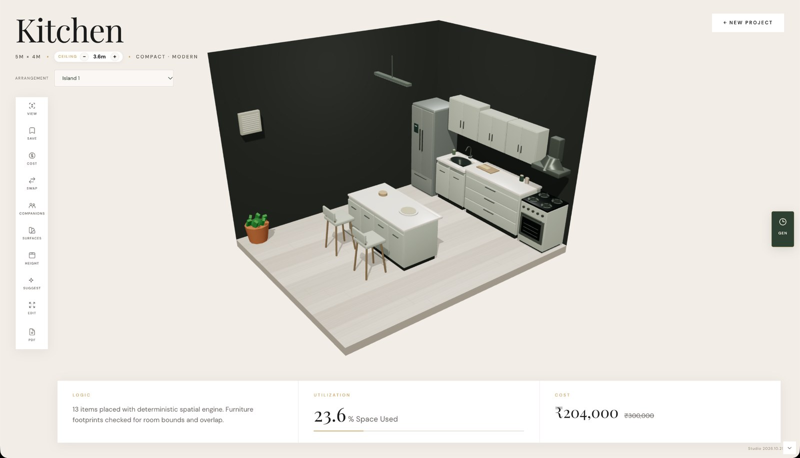
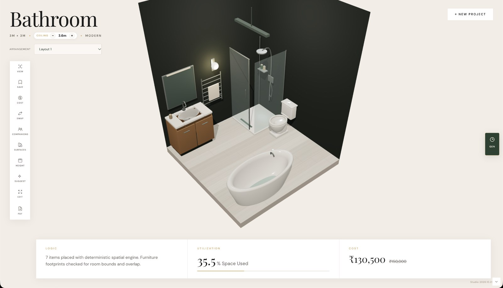

<div align="center">

# LayoutMind Studio

### Considered spaces. Entirely yours.

An interactive room planner that turns room dimensions, design preferences, and a written brief into an editable 3D space.

**6 room types · 8 design styles · 44 furniture & accessory categories**

Local-first · No API key required · macOS & Windows

[Quick start](#-quick-start) · [Features](#-features) · [Gallery](#gallery) · [Development](#development) · [User guide](docs/USER_GUIDE.md) · [Publish to GitHub](PUBLISHING.md)

</div>



## A room you can make your own

Choose a room, set its dimensions and budget, and describe what you have in mind. LayoutMind generates room-specific arrangements that you can refine directly in the browser, from furniture placement to finishes and lighting.

The planner uses rules, room-specific layout families, and spatial constraints to produce candidates. The final design stays editable throughout the workflow.

## ✨ Features

| Area | What you can do |
| --- | --- |
| Room planning | Design living rooms, bedrooms, kitchens, bathrooms, dining rooms, and home offices. |
| Layout alternatives | Compare arrangements, including multiple kitchen layout families. |
| Styles | Choose among eight styles, with coordinated furniture, finishes, and lighting. |
| Furniture studio | Add, move, rotate, resize, duplicate, lock, swap, recolor, or remove furniture. |
| Room finishes | Customize walls, flooring, tiles, fixtures, doors, and decorative details. |
| Camera | Orbit, pan, zoom, switch views, and move the camera up or down. |
| Pets | Invite a chubby cat or pug, add accessories, and choose roaming or staying. |
| Design history | Undo and redo edits; save named designs locally in the browser. |
| Handover | Review indicative INR costs and export PDF or DXF files. |

## 🚀 Quick start

Install **Python 3.12**, extract the complete application ZIP, and open a terminal in the project directory containing `start.py`.

**macOS**

```bash
python3.12 start.py
```

**Windows**

```powershell
py -3.12 start.py
```

The launcher creates the project environment, installs requirements on first launch, and starts the local application. Follow the URL printed in the terminal. Keep that terminal open while using the app; press `Ctrl+C` to stop it.

Use a modern browser with WebGL and hardware acceleration enabled. Initial dependency installation requires internet access. The complete release includes a built frontend, so normal use does not require Node.js. The included `run.command` and `run.bat` provide alternative launchers.

### Useful launch options

```bash
# macOS; use py -3.12 instead of python3.12 on Windows
python3.12 start.py --setup-only
python3.12 start.py --no-browser
python3.12 start.py --port 8001
```

The default port is 8000. If it is occupied, the launcher selects a free port up to 8010. Use the exact address printed in the terminal. Browser saves are scoped to that address and browser profile, so changing ports uses a different set of local saves.

## Design workflow

1. **Define the space.** Select a room type, dimensions, height, style, and budget.
2. **Describe your brief.** Include useful requests such as a bedroom study table or kitchen island.
3. **Compare layouts.** Inspect the generated room and choose an alternative arrangement where available.
4. **Make it personal.** Adjust furniture, colors, surfaces, doors, lighting, and accessories.
5. **Review and save.** Check the estimate, save a design locally, or export it for discussion.

The available styles are **Modern, Luxury, Minimal, Cozy, Compact, Bohemian, Industrial, and Coastal**. Kitchen candidates include **Single-wall, L-shaped, Galley, and Island** layouts where room size and circulation allow them.

Try a brief such as `Cozy bedroom 4x4m with a study table and task chair` or `Luxury kitchen 5x4m with an island under 3 lakh`. Explicit room and dimension controls take precedence over the written prompt.

**Camera tip:** Open **View** for Orbit, Pan, Up/Down, Reset, and view controls. Right-drag pans; the mouse wheel zooms. The Up/Down buttons translate the camera and its focus together in 25 cm steps.

## Gallery

### Living room



### Kitchen



### Bathroom



Screenshots show example configurations; room dimensions, chosen assets, and edits affect the final result.

## How it works

The React interface collects room inputs and presents the 3D editor. A Python/FastAPI planning service interprets supported room requests, selects candidate arrangements, and checks spatial constraints. A shared catalog supplies furniture dimensions and indicative costs. React Three Fiber and Three.js render the scene, while shared application state connects editing, history, local saving, and export.

| Layer | Technology / role |
| --- | --- |
| Interface | React and TypeScript |
| 3D workspace | Three.js and React Three Fiber |
| Shared state | Zustand |
| Planning API | Python and FastAPI |
| Planning method | Rule-based, room-specific candidate generation and evaluation |
| Startup | Cross-platform Python launcher with a bundled production frontend |

## Development

Use **Node.js 22.12+**, npm, and **Python 3.12** for source development. The optional Express proxy and Windows Electron scripts are included; the Python browser launcher is the primary cross-platform entry point.

To run the development interface, first prepare and activate the Python environment from the project root:

```bash
# macOS
python3.12 start.py --setup-only
source .venv/bin/activate
```

```powershell
# Windows PowerShell
py -3.12 start.py --setup-only
.\.venv\Scripts\Activate.ps1
```

Start the planning service in that terminal:

```bash
python -m uvicorn main_fixed:app --app-dir softcomputing-service --host 127.0.0.1 --port 8000
```

In a second terminal, from `frontend`, run `npm ci` followed by `npm run dev`. Vite proxies `/api` to the Python service. Stop the normal bundled launcher before using the same API port.

For frontend checks and a production rebuild, from the `frontend` directory:

```bash
npm ci
npm run lint
npm test
npm run build
```

For Python checks, use a Python 3.12 development environment from the project root:

```bash
python -m pip install -r requirements-test.txt
python -m pytest softcomputing-service/tests tests -q
```

Rebuild the frontend after UI changes before testing the bundled launcher. Check the launcher output for startup errors and the active local URL. See [VALIDATION.md](VALIDATION.md) for the recorded application checks and their limits. The GitHub preparation changes documentation and packaging rules; it does not claim a new full application test run.

### Main source areas

| Location | Purpose |
| --- | --- |
| `start.py` | Environment setup and local application startup |
| `frontend/src/routes` | Homepage, planning, and workspace screens |
| `frontend/src/components` | Editing and customization panels |
| `frontend/src/three` | Room, furniture, lighting, and camera components |
| `frontend/src/lib` | Geometry, editing, persistence, and camera logic |
| `softcomputing-service` | Prompt interpretation, catalog, and room planning |
| `frontend/tests`, `tests` | Frontend and application validation |

## Troubleshooting

| Issue | What to check |
| --- | --- |
| Python command is missing | Install Python 3.12 and reopen the terminal. On Windows, install the Python launcher as well. |
| `No module named packaging` | Launch with `start.py` so dependency setup and import checks run; avoid starting the service with an unrelated Python environment. |
| Empty or unavailable 3D scene | Enable browser hardware acceleration and WebGL, then check the terminal and browser console. |
| An older design or release appears | Stop the old terminal session and use the URL printed by this copy of the launcher. |
| Frontend build is missing | Restore the included `frontend/dist`, or run `npm ci` and `npm run build` inside `frontend`. |
| Named saves seem missing | Use the same browser profile and local port where they were saved. |

## Scope

LayoutMind plans a single rectangular room at a time. Cost figures are catalog-based estimates. Exports support conceptual design review; they are not certified construction, structural, electrical, or plumbing drawings. Named local saves belong to the current browser profile, so export important work before clearing browser storage.

## Copyright

**Copyright © 2026 AHMED SINAAN. All Rights Reserved.** Unauthorized copying, modification, or distribution is strictly prohibited.

The supplied project includes a [GPL-3.0 license](LICENSE), which is retained. The copyright notice above does not replace permissions granted by an applicable existing license. Bundled dependencies and assets retain their respective terms; see [third-party notices](THIRD_PARTY_NOTICES.md) and the `licenses/` directory.
